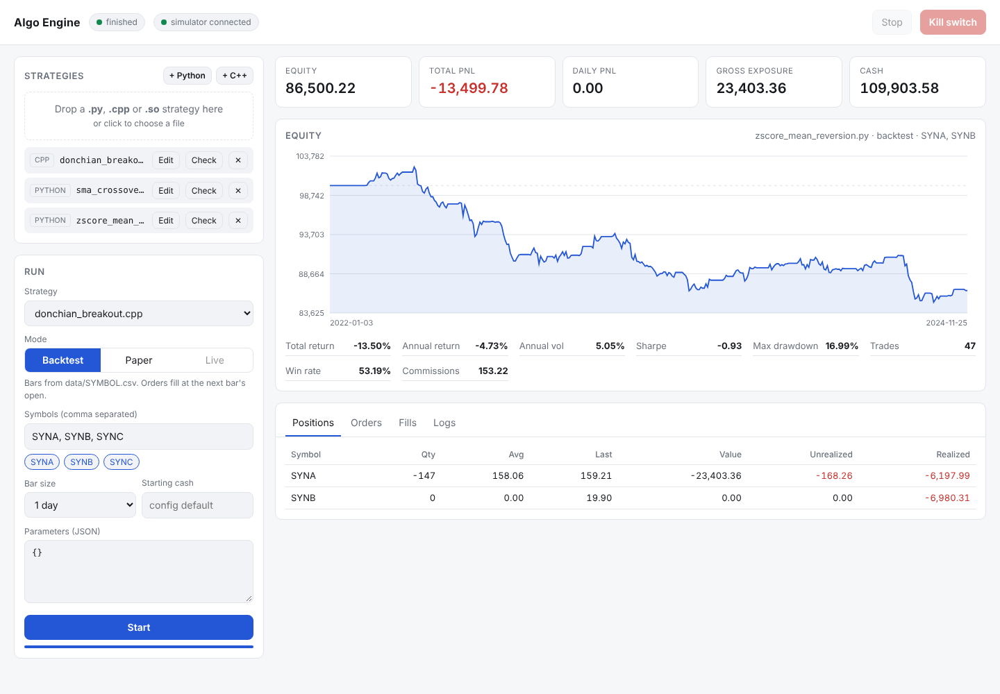

# IBKR Algo Engine

A C++20 algorithmic trading engine for Interactive Brokers. Upload a strategy written in **Python or C++**, backtest it on CSV data, then run the exact same file in **paper** or **live** trading through TWS / IB Gateway. Everything is driven from a local web dashboard or the command line.



## What it does

- **Strategies as plain files.** Drop a `.py`, `.cpp` or `.so` into the dashboard. C++ is compiled on the fly, Python runs in an embedded interpreter. One small API (`on_bar`, `buy`, `sell`, `target_position`, `history`...) for both languages.
- **One engine for backtest and live.** The backtester uses the same `Engine`, risk checks and strategy context as live trading, only the broker changes (simulator vs IBKR).
- **No look-ahead by construction.** Orders sent on bar *t* fill at the earliest on bar *t+1* (market at the open, limit if touched).
- **Risk layer between every strategy and the broker.** Max position, max order notional, gross exposure, order rate limit and a daily loss kill switch that cancels orders and flattens positions.
- **Direct IBKR connection** with the official TWS API C++ client: real-time 5 second bars aggregated to your bar size, warm-up history, order routing, fills, start-up position sync, and a paper-account guard.
- **Local dashboard**: upload and edit strategies, run backtests, watch equity, positions, orders, fills and logs, stop or kill the run.

## Quick start (5 minutes, no IBKR account needed)

Requirements: CMake 3.20+, a C++20 compiler (GCC 11+, Clang 14+), Python 3.10+ with headers (`python3-dev`), git.

```bash
git clone <this repo> && cd <repo>
pip install pybind11                      # optional: otherwise CMake fetches it
cmake -S . -B build -DCMAKE_BUILD_TYPE=Release
cmake --build build -j

# demo data (synthetic, NOT real prices) and example strategies
python3 tools/make_synthetic_data.py --out data
mkdir -p strategies && cp examples/strategies/* strategies/

./build/algoengine init                   # writes config.json
./build/algoengine serve                  # http://127.0.0.1:8080
```

Open http://127.0.0.1:8080, pick `sma_crossover.py`, keep the `SYNA, SYNB, SYNC` symbols, press **Start**.

Command-line equivalent:

```bash
./build/algoengine backtest -s examples/strategies/sma_crossover.py \
    --symbols SYNA,SYNB,SYNC --data data --param fast=10 --param slow=40
```

## Writing a strategy

Python:

```python
import algo

class SmaCross(algo.Strategy):
    def on_start(self, ctx):
        self.fast = ctx.param("fast", 10)      # set from the dashboard or --param
        self.slow = ctx.param("slow", 40)

    def on_bar(self, ctx, bar):
        closes = ctx.closes(bar.symbol, self.slow)
        if len(closes) < self.slow:
            return
        fast = sum(closes[-self.fast:]) / self.fast
        slow = sum(closes) / self.slow
        ctx.target_position(bar.symbol, 100 if fast > slow else 0)
```

C++:

```cpp
#include <algo/strategy/strategy.hpp>

class SmaCross : public algo::Strategy {
 public:
  void on_bar(algo::StrategyContext& ctx, const algo::Bar& bar) override {
    auto h = ctx.history(bar.symbol, 40);
    if (h.size() < 40) return;
    double fast = 0, slow = 0;
    for (size_t i = 0; i < 40; ++i) { slow += h[i].close; if (i >= 30) fast += h[i].close; }
    ctx.target_position(bar.symbol, fast / 10 > slow / 40 ? 100 : 0);
  }
};
ALGO_EXPORT_STRATEGY(SmaCross)
```

Full reference: [docs/strategy-api.md](docs/strategy-api.md). Examples: [examples/strategies](examples/strategies).

## Trading with Interactive Brokers

The IBKR adapter is built against the official TWS API C++ SDK, which IBKR distributes under its own license, so it is not bundled here. Download it, then:

```bash
cmake -S . -B build -DALGO_WITH_IBKR=ON \
      -DTWS_API_DIR=/path/to/twsapi/source/cppclient/client \
      -DTWS_DECIMAL_LIB=/path/to/libbid.a
cmake --build build -j
```

Start TWS or IB Gateway with the API enabled, choose **Paper** in the dashboard (or `algoengine run --mode paper`). Paper mode refuses to connect to a non-paper account. Live mode is disabled until you set `"allow_live": true` in `config.json`.

Step-by-step guide, ports, market data and troubleshooting: [docs/ibkr-setup.md](docs/ibkr-setup.md).

## Configuration

`algoengine init` writes `config.json` with every option. The important ones:

| Key | Default | Meaning |
|---|---|---|
| `ibkr.port` | `4002` | IB Gateway paper. TWS paper 7497, TWS live 7496, Gateway live 4001 |
| `ibkr.client_id` | `17` | Must be unique per API connection |
| `ibkr.warmup_bars` | `200` | History loaded before trading starts |
| `risk.max_position_qty` | `1000` | Absolute shares per symbol |
| `risk.max_order_notional` | `25000` | Per order |
| `risk.max_gross_exposure` | `150000` | Sum of absolute position values |
| `risk.max_daily_loss` | `2000` | Trips the kill switch (UTC day) |
| `risk.max_orders_per_minute` | `30` | Rate limit |
| `commission.*` | IBKR Pro fixed-like | Backtest costs and slippage |
| `allow_live` | `false` | Must be `true` to trade real money |
| `server.host` | `127.0.0.1` | Keep it local: uploads are executable code |

## Project layout

```
include/algo/        public headers (strategy.hpp is the only one strategies need)
src/core/            portfolio, metrics, config
src/engine/          engine, backtester, session manager
src/broker/          simulator and IBKR adapter
src/strategy/        C++ plugin loader, embedded Python host
src/server/          HTTP API + embedded dashboard (web/index.html)
src/app/main.cpp     CLI
tests/               GoogleTest suite (unit, integration, HTTP)
examples/            strategies and synthetic data
docs/                architecture, ADRs, strategy API, IBKR setup, testing, tech debt
```

## Documentation

- [Architecture and design decisions](docs/architecture.md)
- [Strategy API](docs/strategy-api.md)
- [IBKR setup](docs/ibkr-setup.md)
- [Testing strategy](docs/testing.md)
- [Known limitations and tech debt](docs/tech-debt.md)

## Safety

This is a tool, not investment advice. Backtests on synthetic or limited data say little about live results. Paper trade first, keep the risk limits tight, and remember that any uploaded strategy runs with full access to your IBKR session.

## License

MIT, see [LICENSE](LICENSE). The IBKR TWS API is licensed separately by Interactive Brokers.
